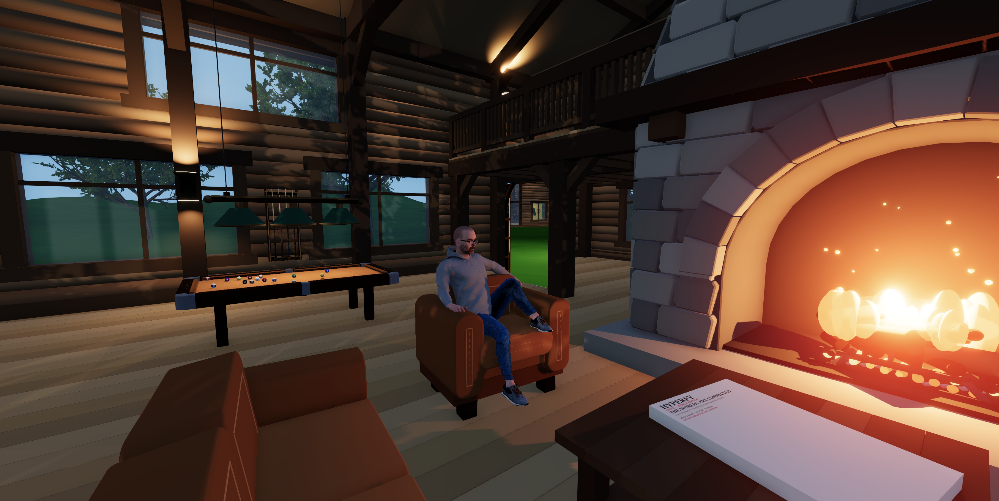

# Jerome's Hyperfy World

This world explicitly runs on [Jérôme’s Hyperfy fork](https://github.com/jerometremblay/hyperfy). The fork supplies the runtime and the `worldsync` tooling used by this repository. Visit the [live world](https://monstre.duckdns.org:3333).



This repository contains the source-first Git representation of Jerome's Hyperfy world. `objects/**/object.json` and per-object source files describe app blueprints; `scenes/local-world/scene.json` records independent placements. Runtime databases, player records, generated bundles, and credentials do not belong here.

## Latest live capture

The October 22, 2026 capture from the `online-world` profile contains 48 live app blueprints, 88 persistent app placements, 151 referenced assets, and 55 saved seat-pose records, together with the protected environment, portable settings, and spawn. Capture preserves source-only resources, so repository totals can exceed live totals. Eleven seat anchors could not be resolved, and four source placements without live mappings were preserved.

Capture reads the running world without changing it. Saved seat poses retain source identity and anchor metadata; destination identity reconciliation is not implemented. Private world settings and transient runtime state are excluded.

## Tooling

Run these commands from the [Hyperfy fork checkout](https://github.com/jerometremblay/hyperfy), with this repository alongside it:

```sh
npm run worldsync -- validate --root ../hyperfy-world-jerome --scene local-world
npm run worldsync -- capture --root ../hyperfy-world-jerome --scene local-world --profile online-world --dry-run
npm run worldsync -- capture --root ../hyperfy-world-jerome --scene local-world --profile online-world --write
npm run worldsync -- build --root ../hyperfy-world-jerome --scene local-world --allow-external
```

The profile is configured in `worldsync.config.json`. Authentication comes from `AGENT_API_WRITE_TOKEN` in the environment or the fork checkout’s local environment files; never commit the token. Capture protects dirty source files and stops on conflicting source and live edits.

`worldsync` can also deploy an existing mapped app blueprint, including its script and assets. Its separate `bootstrap` command uploads scene resources, applies portable settings and spawn, and creates or updates mapped placements. Capture, commits, and pushes do not deploy changes. External asset references require `--allow-external` for builds and make the bundle nonportable. See the fork’s [worldsync documentation](https://github.com/jerometremblay/hyperfy/blob/main/tools/worldsync/README.md) for deployment and bootstrap details.

## Bootstrap history

The initial source tree came from a read-only SQLite backup of the local world: 41 saved blueprint definitions and 49 ordinary app placements, plus the environment. Subsequent live captures update mapped resources while preserving source-only content. Local runtime mappings under `.worldsync/` support repeat captures and deployments.

## Static interaction performance

Static furniture should have zero frame callbacks on both server and client. Cognac seat prompts now restore through the effect-end callback rather than polling effect handles. The regression tests exercise the sibling fork's actual effect and hot-loop paths, including leaving a seat, switching to another app's effect, and suppressing adjacent prompts while seated:

```sh
node --test tests/cognac-seating.test.mjs
```

See the fork's `docs/scripting/performance.md` for the idle callback rule.
